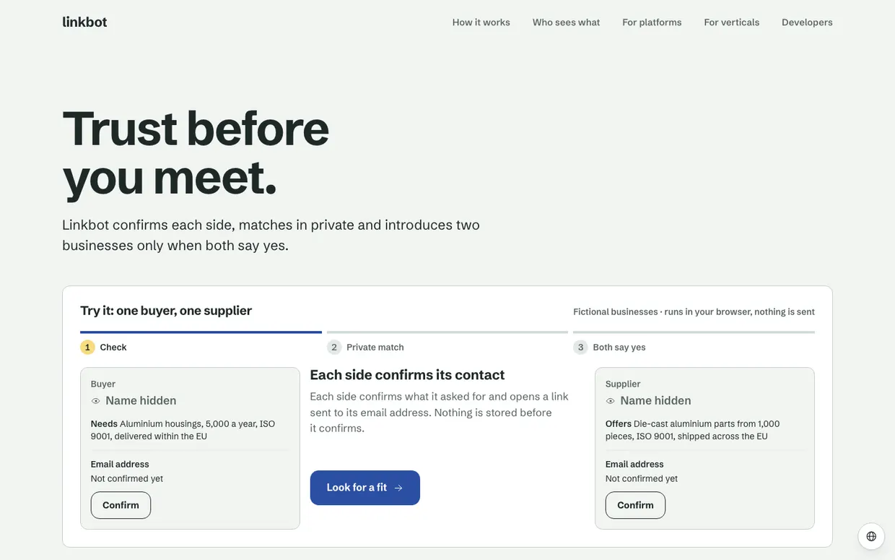
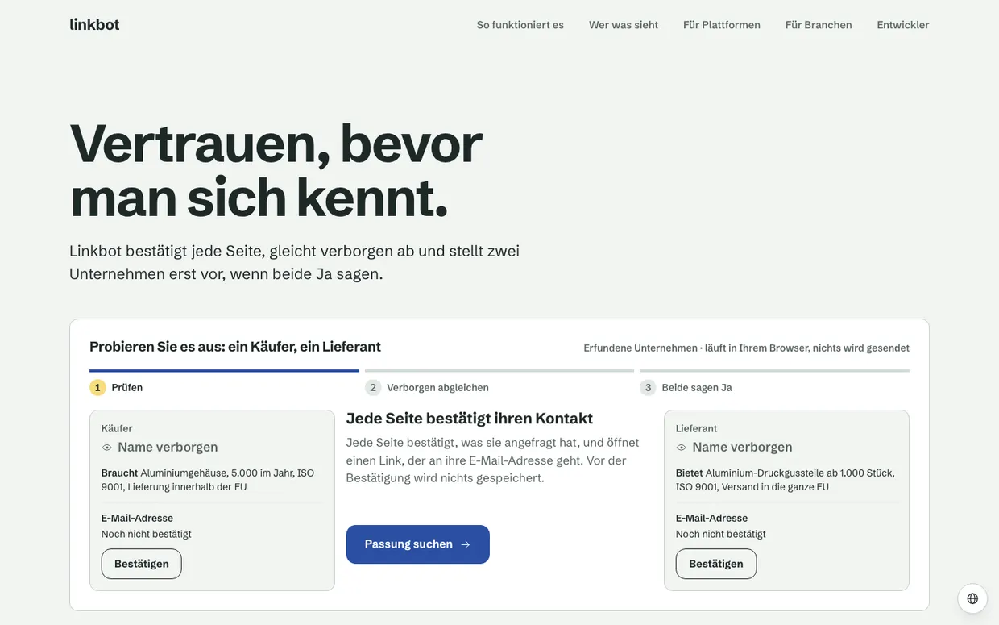
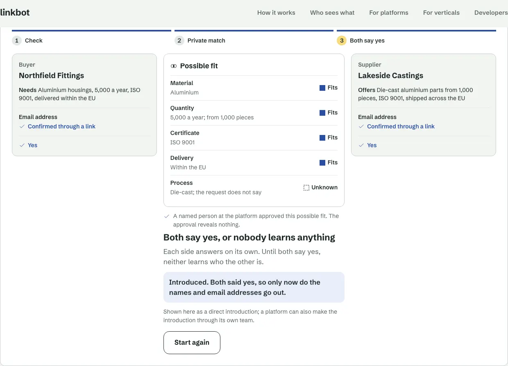
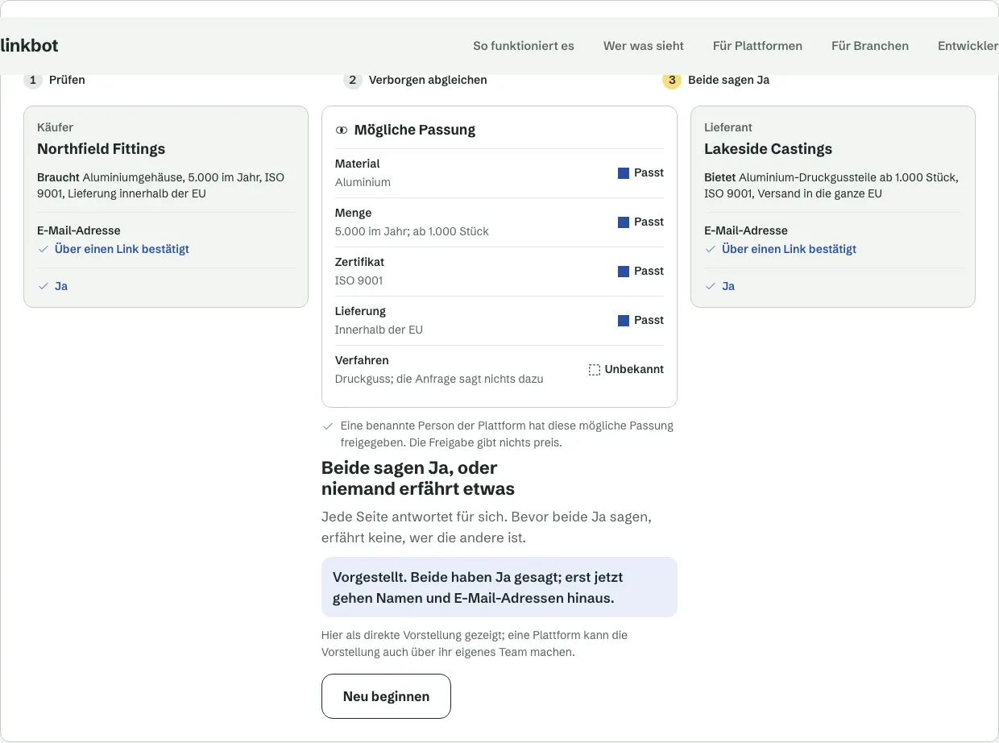
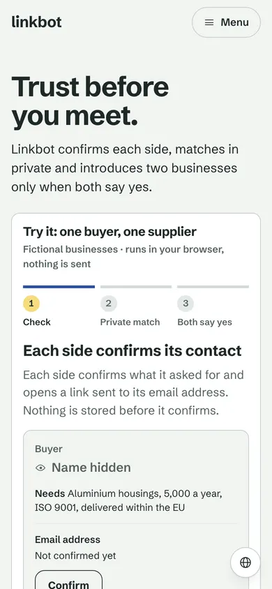
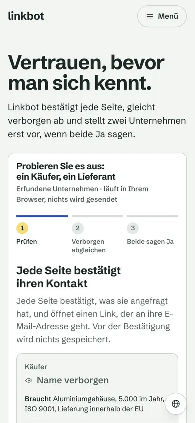
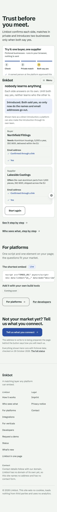
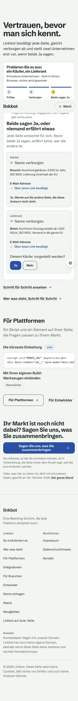

# Home v3: one headline and the "both say yes" demo

The owner's plan of 2026-11-02: a visitor understands Linkbot in five seconds. One headline with the problem and the
promise, and directly under it a demo the visitor taps through instead of a block of explanation. Draft branch
`next/home-v3`, built on `next/site-demo` (keeps the landing page and `/demo` drafts). Not published, not deployed.

## What the page is now

1. **Headline and sub-line.** `src/front/landing-copy.ts` (`opening`), written natively in English and German; Spanish,
   Italian and French in `src/front/i18n/`.
2. **The demo** (`src/components/front/Trial.astro`, logic in `src/front/trial.ts`, styles in `src/front/trial.css`):
   buyer and supplier side by side, Linkbot's step between them; stacked on a phone. Three steps:
   1. *Check*: each side confirms its email address through a link. Only the check that runs today; no company check.
   2. *Private match*: a possible fit with a verdict per criterion and no names; a named person at the platform approves.
   3. *Both say yes*: each side answers alone. Both yes: the names show (a direct introduction). One no: nothing is
      revealed, and the demo says so.
   Plain TypeScript in an Astro script, no framework, no network call, nothing stored. Native buttons, a live region that
   reads out each change, focus kept in the demo when a pressed button goes away, motion only without
   `prefers-reduced-motion: reduce`. Without scripts the page shows the whole path, no buttons.
3. **For platforms** and **the bottom**, unchanged from the landing page.

Taken off the home (they stay on their pages): the three cards, the recorded demo stage (its pictures are `/demo`'s), the
"who sees what" strip. Links under the demo lead to `/demo` and `/who-sees-what`.

## Headline variants

| | English | German |
| -- | -- | -- |
| **A (built)** | Trust before you meet. | Vertrauen, bevor man sich kennt. |
| B | Meet only who wants to meet you. | Lernen Sie nur kennen, wer Sie kennenlernen will. |
| C | Two yeses, then an introduction. | Erst zwei Ja, dann die Vorstellung. |

## The sub-line switch

`src/front/hero.ts` holds `SUBLINE`, `'today'` now:

- **today** (built): "Linkbot confirms each side, matches in private and introduces two businesses only when both say yes."
- **full** (only once company checks run on the space and have a row in `docs/truth-check.md`): "Linkbot checks who is
  real, matches in private and introduces two businesses only when both say yes."

`tests/home.test.mjs` fails if the built home carries the full sub-line in any language.

## Claim table

Every sentence on the home that states a fact, and what makes it true today. "C" is the Space API contract, rows are
`docs/truth-check.md`'s.

| Sentence (English) | True because | Rows |
| -- | -- | -- |
| "Linkbot confirms each side" | `/intake/confirm` (nothing stored before confirm); `/channels`: the email address is confirmed through a link | how.confirm |
| "matches in private" | A possible fit discloses only verdicts at match stage; no name, no contact, no sign of the other's answer (C invariant 3, `/intents/{id}/matches`) | home.rules, how.sees, `/who-sees-what` match stage |
| "introduces two businesses only when both say yes" | `/introductions` is created only after gates, approval and both yes; every other way is refused (C invariant 4, `/matches/{id}/answers`) | home.flow, how.yes |
| "Each side confirms what it asked for and opens a link sent to its email address. Nothing is stored before it confirms." | `/intake/confirm`; `/channels` (address confirmed by link); C invariant 2 | how.confirm |
| "Linkbot compares the two on each criterion. Each side sees the verdicts, never the other's name or contact." | The matching paragraph's verdicts per criterion, never a score; match stage shows no name and no contact | home.lede, how.sees |
| The verdicts "Fits" / "Unknown" | The four verdicts of the contract (meets, partly, conflicts, unknown) | home.lede |
| "A named person at the platform approved this possible fit. The approval reveals nothing." | `/matches/{id}/approval` by a named, active operator; approval discloses nothing | how.approval |
| "Each side answers on its own. Until both say yes, neither learns who the other is." / "Waiting for the other side, which does not see this answer." | `/matches/{id}/answers`; the other side learns nothing before both yes | how.yes |
| "Introduced. Both said yes, so only now do the names and email addresses go out." | The introduction's fields (display name, confirmed email) go out only after both yes | how.introduction |
| "Shown here as a direct introduction; a platform can also make the introduction through its own team." | Modes direct and operator | how.introduction |
| "No introduction. One side said no, so neither learns who the other is." | No introduction without both yes; nothing before it | how.yes |
| "Fictional businesses · runs in your browser, nothing is sent" | `src/front/trial.ts` has no network call (`tests/home.test.mjs` checks the built script) | site.synthetic |
| For platforms, the bottom | unchanged, see the landing page's rows | as in `docs/truth-check.md` |

## Budgets, measured

Lighthouse 12 on the built page (`astro preview`, local), mobile with simulated throttling, 2026-11-03:

| | Performance | Accessibility | Best practices | SEO | LCP | CLS | TBT |
| -- | -- | -- | -- | -- | -- | -- | -- |
| `/` | 99 | 100 | 100 | 100 | 1.4 s | 0 | 30 ms |
| `/de` | 100 | 100 | 100 | 100 | 1.4 s | 0 | 0 ms |

The home's JavaScript: four inline scripts, 2.3 KB gzip together (budget 90 KB). Total page weight 61 KiB.

Not measured: a real phone, a screen reader by hand (the live region and focus were checked in a scripted browser only).

## Screenshots

Desktop 1440 × 900, mobile 390 × 844 at 2× (full page from the second step on).

| | English | German |
| -- | -- | -- |
| Desktop, first view |  |  |
| Desktop, introduced |  |  |
| Mobile, first view |  |  |
| Mobile, later |  |  |

More: `home-v3/en-desktop-3-match.webp` (the possible fit), `home-v3/en-desktop-6-declined.webp` (one no),
`home-v3/en-desktop-nojs.webp` (without scripts).
